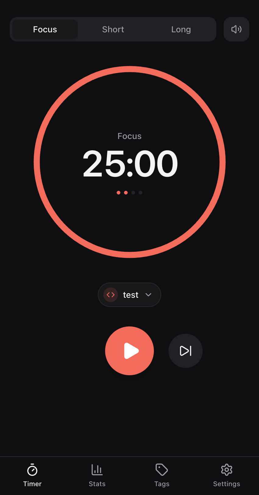
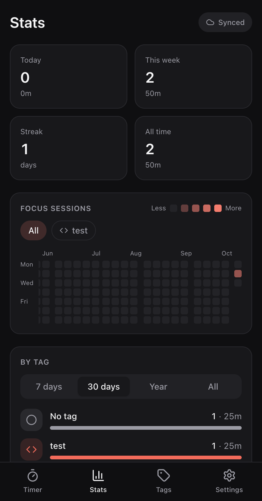
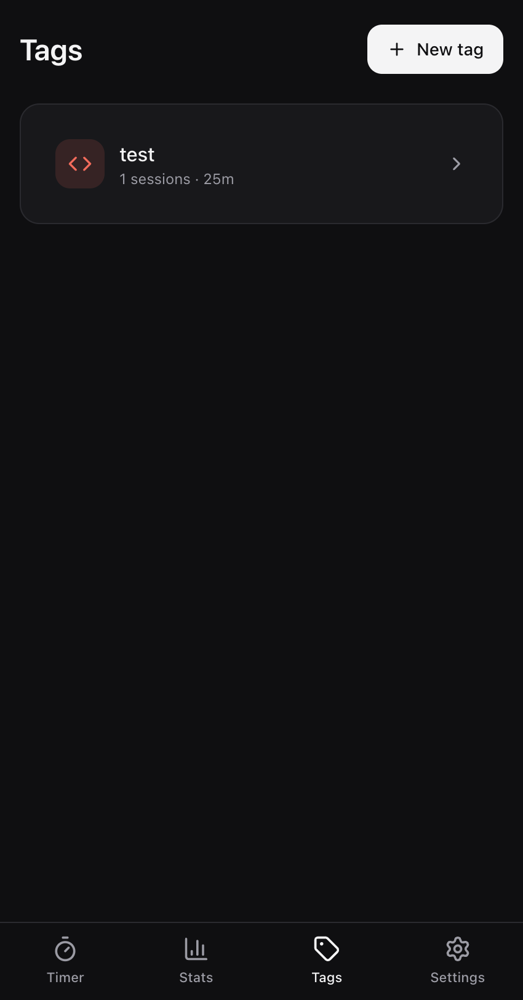
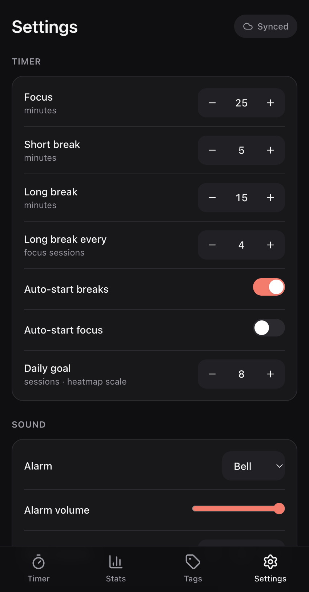

# Tomate

[](https://github.com/Veuge/tomate/actions/workflows/ci.yml)

Minimal, cross-device Pomodoro (tomate) timer: focus / short break / long break, loud alarms,
auto or manual start, background sounds, colored tags with icons, a GitHub-style
heatmap and per-tag stats. Installable as a PWA on iOS, Android, macOS and Windows.
Sessions from every device sync to one account through Supabase.

| Timer | Stats | Tags | Settings |
|:---:|:---:|:---:|:---:|
|  |  |  |  |

## Run

```sh
npm install
npm run dev          # http://localhost:5173
npm test             # timer engine + stats unit tests
npm run build        # typecheck + production build (with service worker)
```

Dev tip: `http://localhost:5173/?speed=60` makes one minute last one second
(dev builds only), handy for checking alarms and auto-start.

Without Supabase configured the app works fully offline on one device (IndexedDB).

## Enable sync (Supabase)

1. Create a project at supabase.com (free tier is fine).
2. SQL editor → run `supabase/migrations/0001_init.sql`.
3. Authentication → URL Configuration: set **Site URL** to where the app is hosted and
   add `http://localhost:5173` to **Redirect URLs**.
4. Copy `.env.example` to `.env.local` and fill in the project URL and anon key
   (Project Settings → API).
5. Restart `npm run dev`, open Settings → Sign in, and use the emailed magic link.

## Install as an app

The PWA install needs HTTPS, so deploy `dist/` to any static host (Vercel, Netlify,
Cloudflare Pages) with SPA fallback to `index.html`.

- **iOS / iPadOS:** Safari → Share → Add to Home Screen
- **Android:** Chrome → Install app
- **macOS / Windows:** Chrome or Edge → install icon in the address bar (Safari on macOS: File → Add to Dock)

## Release

Releases happen when a PR is merged into `main`. Before merging, add one label to the PR:
`release:patch`, `release:minor` or `release:major`. The Release workflow
(`.github/workflows/release.yml`) then bumps `package.json` and `package-lock.json`,
commits and tags `vX.Y.Z` on `main`, deploys that build to Cloudflare and creates a GitHub
Release. PRs merged without a release label are not released or deployed. The version is
shown in Settings → Account & data.

## How it works

- `src/features/timer/engine.ts`: a pure state machine. Time comes from timestamps
  (`endsAt`), so it stays correct when the tab is throttled or reloaded. If the app was
  closed past the end, the phase completes once on reopen, and an auto-started next
  phase begins at that moment (time spent away is never counted).
- `src/lib/sync.ts`: offline-first. Writes go to IndexedDB with `dirty=1`, get pushed
  as upserts (ids are client-generated UUIDs), and changes are pulled with a
  server-assigned `synced_at` cursor. Realtime keeps other open devices live. If two
  devices edit the same row, the newest `updated_at` wins. Deletes are soft (`deleted`).
- Stats count **completed focus sessions**, bucketed by the viewing device's local day.
  Skipped sessions over one minute are kept as "partial" but not counted.

## Known limits

- **Backgrounded mobile PWAs are suspended** (especially on iOS), so the alarm sounds
  when you return to the app, not exactly at the end. The timer itself stays accurate.
  Planned fix: Web Push sent from a Supabase Edge Function at `endsAt`.
- iOS silences web audio when the ring/silent switch is on.
- Notification permission is requested on your first Start tap.
